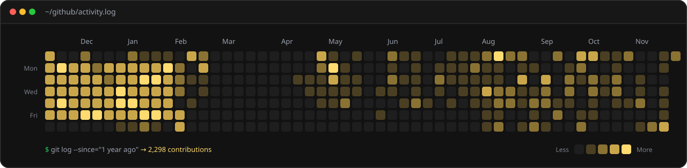

  
  
  

### 👨‍💻 About me

I build **backend-heavy products end to end**: Django and Flask APIs, the PostgreSQL schemas under them, and the React and React Native apps on top. My final-year project trained **four deep-learning models** that classify brain MRI scans, and I'm now taking that AI background into **agentic systems** in Python.

- 🏗️ **Backend:** Django / DRF, Flask, tRPC, auth (JWT, OTP), payments, dispatch, background events
- 📱 **Mobile and web:** React Native / Expo, React, Next.js, Electron, bilingual EN/AR with RTL
- 🧠 **AI:** TensorFlow / Keras, CNNs and transfer learning; now working on LLM agents, tool calling and RAG
- 🏢 **Product Developer** at Abdulaziz Turki Al Otaishan Company in **Riyadh**, with freelance work alongside for clients in KSA and Pakistan

 

## 🧰 Tech stack

**Backend and APIs** 
      

**AI and data science** 
   

**Databases** 
     

**Frontend, mobile and desktop** 
        

**DevOps and tooling** 
     

 

## 📊 GitHub activity

 

## 💼 Experience

<table>
  <tr><td width="280"><b>Abdulaziz Turki Al Otaishan Company</b></td><td>Product Developer</td><td>Oct 2025 – present · Riyadh</td></tr>
  <tr><td><b>Freelance</b> (alongside)</td><td>Full-stack developer</td><td>Oct 2025 – present · Riyadh</td></tr>
  <tr><td><b>Mars BPO</b></td><td>Full-stack developer</td><td>Jul 2024 – Aug 2025 · Islamabad</td></tr>
  <tr><td><b>Focal Technologies</b></td><td>Full-stack developer</td><td>Sep 2023 – Jul 2024 · Islamabad</td></tr>
  <tr><td><b>SOFTOO</b></td><td>JavaScript developer intern</td><td>Jul 2023 – Sep 2023 · Islamabad</td></tr>
  <tr><td><b>CUST</b></td><td>BS Software Engineering</td><td>2020 – 2024</td></tr>
</table>

 

## 🔭 Currently

Going deeper on **agentic AI in Python**: tool calling, structured outputs, retrieval, and how to test agents so they behave predictably in a real backend.

 

The banner matches my <a href="https://hanihashmi.vercel.app">portfolio</a> and is generated by <a href="./tools/make_banner.py">one script</a>.

