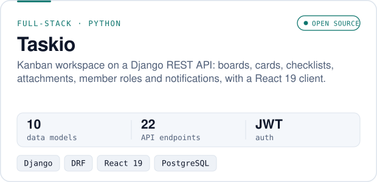
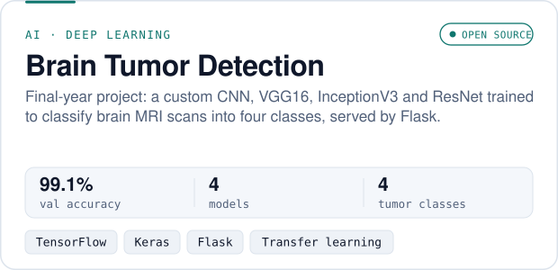
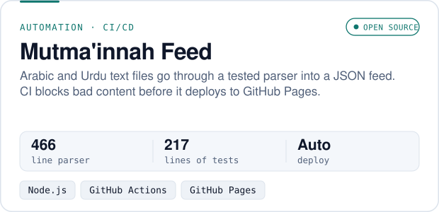
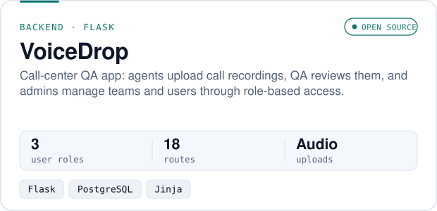

<picture>
  <source media="(prefers-color-scheme: dark)" srcset="./assets/banner-dark.svg">
  <source media="(prefers-color-scheme: light)" srcset="./assets/banner-light.svg">
  
</picture>

  
  
  

### 👨‍💻 About me

I build **backend-heavy products end to end**: Django and Flask APIs, the PostgreSQL schemas under them, and the React and React Native apps on top. My final-year project trained **four deep-learning models** that classify brain MRI scans, and I'm now taking that AI background into **agentic systems** in Python.

- 🏗️ **Backend:** Django / DRF, Flask, tRPC, auth (JWT, OTP), payments, dispatch, background events
- 📱 **Mobile and web:** React Native / Expo, React, Next.js, Electron, bilingual EN/AR with RTL
- 🧠 **AI:** TensorFlow / Keras, CNNs and transfer learning; now working on LLM agents, tool calling and RAG
- 🌍 Based in **Riyadh, Saudi Arabia**, building products for clients in KSA and Pakistan

 

## 🚀 Featured projects

  
  

  
  

 

## 🧰 Tech stack

**Backend and APIs** 
      

**AI and data science** 
   

**Databases** 
     

**Frontend, mobile and desktop** 
        

**DevOps and tooling** 
     

 

## 📊 GitHub activity

  <picture>
    <source media="(prefers-color-scheme: dark)" srcset="https://streak-stats.demolab.com/?user=hanihashmi786&background=0B1220&border=22304A&stroke=22304A&ring=2DD4BF&fire=F5B544&currStreakNum=E6EDF7&sideNums=E6EDF7&currStreakLabel=2DD4BF&sideLabels=8B9BB4&dates=8B9BB4">
    
  </picture>

  <picture>
    <source media="(prefers-color-scheme: dark)" srcset="https://github-readme-activity-graph.vercel.app/graph?username=hanihashmi786&bg_color=0B1220&color=8B9BB4&title_color=E6EDF7&line=2DD4BF&point=F5B544&area=true&area_color=2DD4BF&hide_border=true&custom_title=Contribution%20activity">
    
  </picture>

 

## 💼 Experience

<table>
  <tr><td width="170"><b>Freelance</b></td><td>Full-stack developer</td><td>Oct 2025 – present · Riyadh</td></tr>
  <tr><td><b>Mars BPO</b></td><td>Full-stack developer</td><td>Jul 2024 – Aug 2025 · Islamabad</td></tr>
  <tr><td><b>Focal Technologies</b></td><td>Full-stack developer</td><td>Sep 2023 – Jul 2024 · Islamabad</td></tr>
  <tr><td><b>SOFTOO</b></td><td>JavaScript developer intern</td><td>Jul 2023 – Sep 2023 · Islamabad</td></tr>
  <tr><td><b>CUST</b></td><td>BS Software Engineering</td><td>2020 – 2024</td></tr>
</table>

 

## 🔭 Currently

Going deeper on **agentic AI in Python**: tool calling, structured outputs, retrieval, and how to test agents so they behave predictably in a real backend.

 

The banner and project cards are self-hosted SVGs generated by the scripts in <a href="./tools">/tools</a>. Every number comes from the project's own code.

