<picture>
  <source media="(prefers-color-scheme: dark)" srcset="./assets/banner-dark.svg">
  <source media="(prefers-color-scheme: light)" srcset="./assets/banner-light.svg">
  
</picture>

  <a href="https://hani-hashmi-portfolio.vercel.app/"><b>Portfolio</b></a>
  &nbsp;·&nbsp;
  <a href="https://linkedin.com/in/hanihashmi786"><b>LinkedIn</b></a>
  &nbsp;·&nbsp;
  Riyadh, Saudi Arabia

 

I'm a software engineer who works backend-first. Most of what I build has a **Python service** at its core — Django REST or Flask, PostgreSQL, JWT auth, file handling — and a **React or React Native** client on top. I studied Software Engineering at CUST Islamabad, where my final-year work was a deep-learning system that classifies brain MRI scans. Since then I've shipped web and mobile products for teams in Pakistan and Saudi Arabia, and I'm now pointing that backend experience at **LLM agents**: tool calling, retrieval, and the evaluation work that makes them dependable in production.

 

## Selected work

#### [Taskio](https://github.com/hanihashmi786/Taskio) &nbsp;Django REST Framework · PostgreSQL · React 19 · Vite
Full-stack Kanban workspace. The API models boards, lists, cards, checklists, labels, comments, attachments, board membership and notifications, behind JWT authentication. The React client adds drag-and-drop with dnd-kit, a rich-text card editor, and custom board backgrounds. Configured for production with environment-based settings, `DATABASE_URL`, Gunicorn and WhiteNoise.

#### [Brain Tumor Detection](https://github.com/hanihashmi786/Brain-Tumor-Detection) &nbsp;TensorFlow / Keras · Flask · Firebase Auth
My final-year project: four classifiers trained on brain MRI scans across four classes (glioma, meningioma, pituitary, no tumor) — a custom CNN plus transfer learning on VGG16, InceptionV3 and ResNet. ResNet reached 99.1% validation accuracy in the training logs. A Flask app serves all four models so their predictions can be compared side by side.

#### [mutmainnah-content](https://github.com/hanihashmi786/mutmainnah-content) &nbsp;Node.js · GitHub Actions · GitHub Pages
The content pipeline behind a mobile app. Plain-text files written in Arabic and Urdu go through a tested parser and are published as a JSON feed. CI runs the parser tests and checks every file before deploying, so a bad edit can't reach users.

<b>Also built</b>

 

- **[VoiceDrop](https://github.com/hanihashmi786/VoiceDrop)**: a Flask + PostgreSQL tool for call-center QA. Agents upload call recordings, entries are sent to QA review, and admins manage teams and users through role-based access.
- **[Dial-Loom](https://github.com/hanihashmi786/Dial-Loom)**: a UI prototype for a React Native softphone, with navigation, Redux-persisted auth, and dialer, SMS and number screens.
- **[Rujo-illalah](https://rujoilallah-app.vercel.app)**: an Islamic mobile app built in React Native as freelance work. The repository is private.

 

## Toolbox

<table>
  <tr>
    <td width="150"><b>Backend</b></td>
    <td>Python · Django · Django REST Framework · Flask · Node.js · Express · REST APIs · JWT</td>
  </tr>
  <tr>
    <td><b>AI / ML</b></td>
    <td>TensorFlow · Keras · CNNs &amp; transfer learning · NumPy · Jupyter</td>
  </tr>
  <tr>
    <td><b>Data</b></td>
    <td>PostgreSQL · SQLite · MongoDB · Redis · Firebase</td>
  </tr>
  <tr>
    <td><b>Frontend &amp; mobile</b></td>
    <td>React · React Native · Expo · TypeScript · Next.js · Tailwind CSS · Redux Toolkit · Zustand</td>
  </tr>
  <tr>
    <td><b>Delivery</b></td>
    <td>Git · GitHub Actions · Gunicorn · Nginx · Vercel · Linux</td>
  </tr>
</table>

 

## Experience

<table>
  <tr><td width="150"><b>Freelance</b></td><td>Full-stack developer</td><td>Oct 2025 – present · Riyadh</td></tr>
  <tr><td><b>Mars BPO</b></td><td>Full-stack developer</td><td>Jul 2024 – Aug 2025 · Islamabad</td></tr>
  <tr><td><b>Focal Technologies</b></td><td>Full-stack developer</td><td>Sep 2023 – Jul 2024 · Islamabad</td></tr>
  <tr><td><b>SOFTOO</b></td><td>JavaScript developer intern</td><td>Jul 2023 – Sep 2023 · Islamabad</td></tr>
  <tr><td><b>CUST</b></td><td>BS Software Engineering</td><td>2020 – 2024</td></tr>
</table>

 

## Currently

Going deeper on **agentic AI in Python**: tool calling, structured outputs, retrieval, and how to test agents so they behave predictably in a real backend.

 

Built by hand: the banner is a self-hosted SVG generated from <a href="./tools/make_banner.py">one script</a>, with no third-party widgets.

